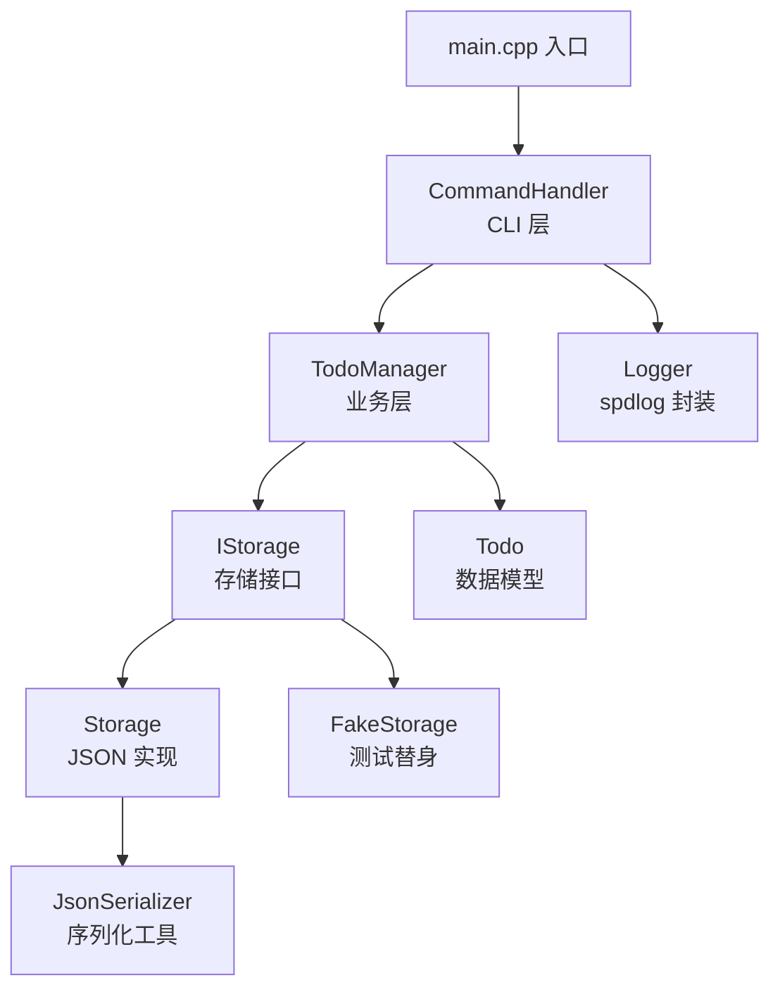

# Todo CLI 架构说明

## 1. 概述

Todo CLI 是一个 C++17 命令行待办事项管理工具，支持任务的添加、查看、完成、删除、搜索与编辑。业务逻辑（TodoManager）与数据持久化（Storage）通过 IStorage 接口解耦，数据默认以 JSON 文件保存，当前存储实现为「整量快照」读写。

## 2. 分层架构

| 层 | 组件 | 职责 |
|---|---|---|
| CLI 层 | CommandHandler | 解析命令、校验输入、调用业务、打印结果 |
| 业务层 | TodoManager、Todo | 任务的增删改查、完成/搜索/编辑；持有内存列表 |
| 存储层 | IStorage → Storage | 定义存储契约；Storage 用 JSON 实现，JsonSerializer 负责序列化 |
| 测试 | FakeStorage | 内存版存储替身，让业务测试不碰磁盘 |

**依赖方向（单向）：** CLI → 业务 → 存储接口。上层依赖接口、不依赖具体实现；Storage 不知道 TodoManager 的存在，只知道 std::vector<Todo>。

## 3. 数据流

以 `./build/todo add "写文档"` 为例：

1. main 把 argv 传给 CommandHandler::handle()
2. CommandHandler 解析出子命令 add 和参数 "写文档"
3. 调用 TodoManager::addTodo("写文档")
4. TodoManager 生成新 id、加进内存列表，再调用 storage.save(todos)
5. Storage 用 JsonSerializer 把整个列表序列化成 JSON，写入 data/tasks.json

加载时方向相反：TodoManager 构造时调用 storage.load()，把文件内容读回内存列表。

## 4. 关键设计决策（为什么这么设计）

### 4.1 为什么用 IStorage 接口？

**目的**：让业务层不依赖具体存储实现。

**好处**：① 可测试——用 FakeStorage 内存替身，业务测试不碰磁盘；② 可扩展——将来把 JSON 换成 SQLite，只需新增一个实现 IStorage 的类，TodoManager 一行不改。

**代价**：接口是「最小公分母」，当前 load/save 只能表达整量快照，表达不了更细粒度操作。

### 4.2 为什么 load()/save() 是「全量快照」？

**现状**：每次保存都序列化整个列表覆盖写文件，加载也整份读入内存。

**好处**：实现简单，单人小数据量够用。

**代价**：数据量大时每次改动都全量读写；无法支持多人并发（后写者覆盖先写者）。这正是后续要改成「按任务读写 + SQLite」的根本原因。

### 4.3 已知设计问题：业务层直接打印

TodoManager 内部直接 std::cout 输出，把「业务逻辑」和「终端展示」耦合在了一起。

**改进方向**：把打印移回 CLI 层，业务层只返回数据。

## 5. 数据模型

| 字段 | 类型 | 含义 |
|---|---|---|
| id | int | 任务唯一标识，由 generateNextId() 生成 |
| text | string | 任务内容 |
| done | bool | 是否完成 |

## 6. 当前已知局限

- Storage::save() 未检查文件打开/写入失败，可能「保存失败却提示成功」
- main() 处理完始终返回 0，失败时无法给调用方非零退出码
- 默认数据路径 data/tasks.json 相对运行目录，由 TODO_DATA_FILE 覆盖，未完全消除对运行目录的依赖
